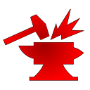
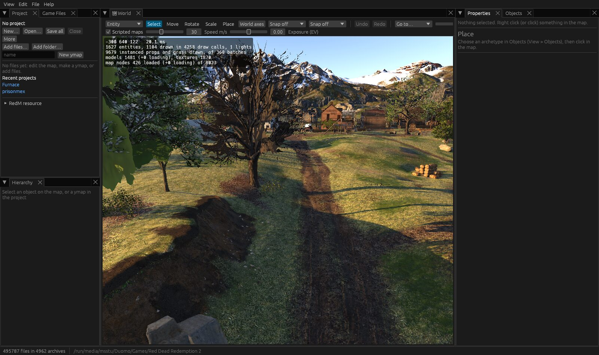
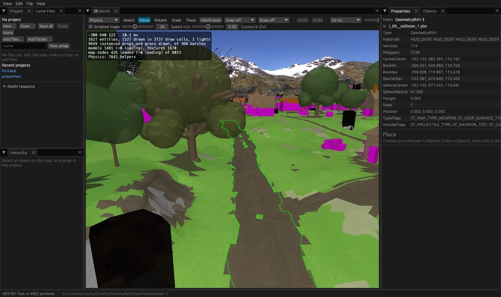
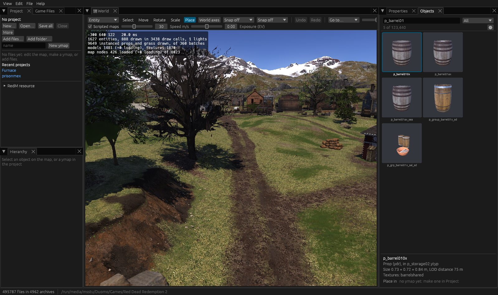

<p align="center">
  
</p>

<h1 align="center">RedForge</h1>

<p align="center">
  <b>A map editor for RedM</b>: Red Dead Redemption 2's world, models and textures, on Windows and Linux.
</p>

<p align="center">
  
  
  
  
</p>



RedForge streams the game's map around you and lets you change it: move, add
and remove entities, interiors, trees and grass, place any object of the game
or of your mod, and export the result as a RedM resource. It reads and writes
the game's file formats exactly as RedForge 1.x did, converts them to and from
the CodeX/Sollumz XML, and works hand in hand with Blender.

This is RedForge 2, rewritten in Rust. What changed in each version is in the
[changelog](CHANGELOG.md); the versions follow [Semantic Versioning](https://semver.org).

## Features

- **The world as the game draws it**: the streamed map with its LODs,
  interiors, terrain, water, instanced trees and grass, lights, shadows, sky
  and weather, at any hour.
- **Editing with undo**: select, move, rotate, scale, duplicate, copy, delete,
  drop to the ground, edit every field in Properties; LOD links kept right.
  Shortcuts for everything (F1 lists them).
- **Placing**: every archetype of the game and of your mod, with 3D
  thumbnails; its model shows where a click will put it.
- **Selection modes**: collisions, navmeshes, occluders, interiors' rooms and
  portals, time cycle modifiers, ambient mask volumes, scenario points,
  lights and skeletons, to see and inspect.
- **Projects**: `.rfproj` files (compatible with RedForge 1.x) hold your
  ymaps, ytyps, models and textures (drop them, or their Sollumz XML, on the
  window), are autosaved, and export as a ready-to-stream RedM resource.
- **Blender**: send the selection to Blender, edit it, and see it back on the
  map immediatly.
- **Viewers** for models, textures, animations (played on peds and animals),
  XML and hex; any game file exported as XML or extracted, and `rf`, a
  command-line tool for the game's archives.

## Install

| | |
|---|---|
| **Windows 10/11** | The `.msi` from the [releases](../../releases). Windows may warn about an unknown publisher: the installer isn't signed. |
| **Arch Linux** | `redforge-bin` or `redforge-git` from the AUR (as soon as it takes new accounts again), or `makepkg -si` in `packaging/arch` from a clone. |
| **Debian, Ubuntu** | The `.deb` from the releases: `sudo apt install ./redforge_*_amd64.deb` |
| **Any Linux** | The AppImage from the releases (`chmod +x`, then run it), or the Flatpak bundle: `flatpak install --user RedForge-*.flatpak` |
| **From source** | See [building](#building-from-source). |

You need **Red Dead Redemption 2** installed (Steam, Rockstar Games Launcher
or Epic): RedForge reads its files and never changes them. The GPU needs
Vulkan (Linux) or DirectX 12 / Vulkan (Windows).

## Getting started

1. Start RedForge and choose the game folder, the one with `RDR2.exe` (found
   by itself when Steam, Rockstar, Epic or Heroic installed it). The first
   time, a short tour shows what each panel does (Help > Tour of the panels
   shows it again).
2. Click **Open the world map**, or a town under it.
3. Look around by dragging the mouse; WASD moves, R and F go up and down,
   Shift goes faster, the wheel sets the speed. "Go to…" jumps to a town.
4. Right click (or click) to select; Q moves, E rotates; Properties edits.
5. **New…** in the Project pane saves your work as an `.rfproj`; Ctrl+S saves its files.
6. **RedM resource**, under the Project pane's files, exports the resource for
   your server (add `ensure <name>` to `server.cfg`).

## Controls

| | |
|---|---|
| Drag, WASD, R / F, Shift, wheel | Look around, move, up / down, faster, speed |
| Right click (or click) | Select; with Ctrl, add or remove |
| Q, E, T, P | Move, rotate, scale, place; V back to selecting |
| `.` | Gizmo along the world's or the object's axes |
| Shift at the start of a gizmo drag | Drag copies (Alt during a drag: ten times slower) |
| Ctrl+Shift+D | Copy the selection as far again as the last drag (the next fence of a row) |
| Arrows, Page Up / Down | Move the selection a snap step, or 10 cm (Shift: ten) |
| Delete, Ctrl+D, Ctrl+X, Ctrl+C, Ctrl+V | Delete, duplicate, cut, copy, paste (into the ymap chosen in Project) |
| Ctrl+Z, Ctrl+Y | Undo, redo |
| Ctrl+S, Ctrl+O, Ctrl+E | Save the project's files, open a project, export the RedM resource |
| Home | Look at the selection |
| End | Drop the selection onto the ground, building or interior floor under it |
| Ctrl+B | Edit the selection in Blender (also the map's **Blender** button) |
| Esc | Cancel a drag; clear the selection; leave the Place tool |
| F1 | All the shortcuts |

## Selection modes



The menu at the start of the map's toolbar picks what you see and select.
Every mode but Entity shows its helpers over the map; hover one for its name,
select it for its fields in Properties.

| Mode | Shows |
|---|---|
| Entity | The map's entities (the default) |
| Light | The entities' lights, picked by their reach |
| Physics | The collisions around you, the world's and the entities', by material |
| Navmesh | The navigation meshes around you |
| Skeleton | The bones of the entities that have one |
| Occlusion | The ymaps' box occluders and occlude models |
| Interior Instance | The interiors' rooms, portals and time cycle modifiers |
| Time Cycle Modifier | The ymaps' time cycle modifier boxes |
| Ambient Mask Volume | The ambient mask volumes |
| Scenario | The scenario points around you |

Helpers can't be moved or edited yet.

## Placing objects



Find the object in **Objects** (beside Properties): the search matches names
and the ytyps they're in, and the list narrows to props, drawable
dictionaries, fragments or interiors. Click it, and its model follows the
mouse on the map; a click places it in the ymap chosen under "Place in"
(Q and E turn it, a right click stops).

## Projects and RedM resources

A project is your mod: the ymaps and ytyps you edit (editing anything of the
game puts its ymap in the project) and the models, textures, collisions and
ytyps you add, which replace the game's of the same name and show in Objects.
The Project pane groups them by type; Save all (Ctrl+S) writes them next to
the `.rfproj` (keeping the previous version as `.bak`), and RedForge reopens
the last project, and the world map where you left it, when it starts.
Unsaved changes are autosaved every two minutes, and offered back if
RedForge closes before they're saved.
Double-clicking an `.rfproj`, or dropping it on the window, opens it too (in
the RedForge already open, if there's one); game files dropped on the window
join the project, and their XML from Sollumz or CodeX is converted first.

**RedM resource** exports the project to `<resources folder>/<name>/`, with
a `stream` folder and an `fxmanifest.lua` (an existing manifest keeps your
edits), on demand or on every save. **Generate _manifest.ymf** lists the
ytyps your ymaps need.

## Blender

Install `blender/redforge_bridge` (in the installed RedForge's folder, or
`/usr/share/redforge/blender` on Linux) as an extension in Blender 5, with
Sollumz RDR. While both run, the map's **Blender** button (Ctrl+B, or Edit >
Edit in Blender; its dot is lit while a Blender is connected) sends the
selection's models (as Sollumz XML) and their placements; the models Blender
sends back go in the project's folder and show on the map, and moving objects
in Blender moves them in RedForge.

## Exporting game files

In Game Files, a file's or a folder's right click exports it into a folder of
your choice: **Export as XML** (as Sollumz and CodeX read it, textures as DDS
files next to it), **Extract** (as a RedM resource streams it) or **Extract
uncompressed**. **Edit > Export selection** writes the selected objects'
models as XML, with the textures they use.

## Command-line tool

```sh
rf ls ymap                       # every path containing "ymap"
rf extract --filter twi_01_strm -o out          # decompressed files
rf extract --loose --filter twi_01_strm -o out  # as RedM loads them from stream/
rf xml out/foo.ydr               # foo.ydr.xml, and foo/ with the DDS textures
rf from-xml out/foo.ydr.xml      # and back
rf hash prop_name
```

It finds the game through `REDFORGE_GAME_DIR` (or `--game`). Paths start
from the game folder and are `/`-separated, like
`levels_3.rpf/levels/rdr3/interiors/van_farmhouse01_int.rpf/van_03_monster.ydr`.

## Building from source

With a recent stable Rust and a Vulkan driver:

```sh
git clone https://github.com/Simomagy/RedForge.git
cd RedForge
cargo run --release -p rf-app
```

[docs/DEVELOPMENT.md](docs/DEVELOPMENT.md) has the crates, the tests and how
the packages (MSI, Arch, AUR, `.deb`, AppImage, Flatpak) are built.

## Contributing

Bug reports and ideas are welcome: open an issue with the bug, file format
or feature form. Please follow the [code of conduct](CODE_OF_CONDUCT.md).

## Credits

RedForge 2 is a rewrite of RedForge 1.x (C#), which grew out of CodeX. Its
XML is CodeX's and Sollumz's, so files go back and forth with them. Built
with [egui](https://github.com/emilk/egui) and [wgpu](https://github.com/gfx-rs/wgpu).

Red Dead Redemption 2 is Rockstar Games'. RedForge is a fan-made tool, not
affiliated with or endorsed by Rockstar Games or Take-Two Interactive.

## License

MIT or Apache-2.0, at your option ([LICENSE-MIT](LICENSE-MIT),
[LICENSE-APACHE](LICENSE-APACHE)).
